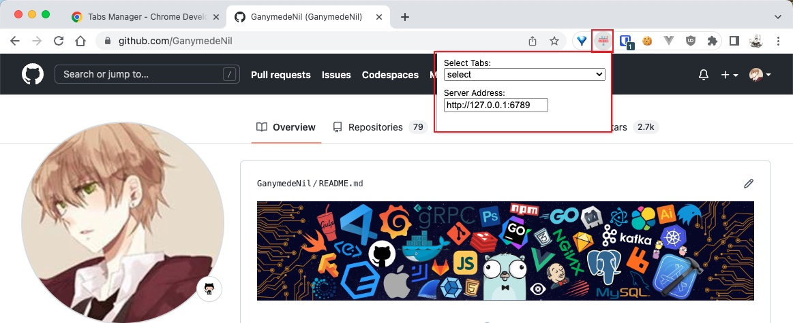
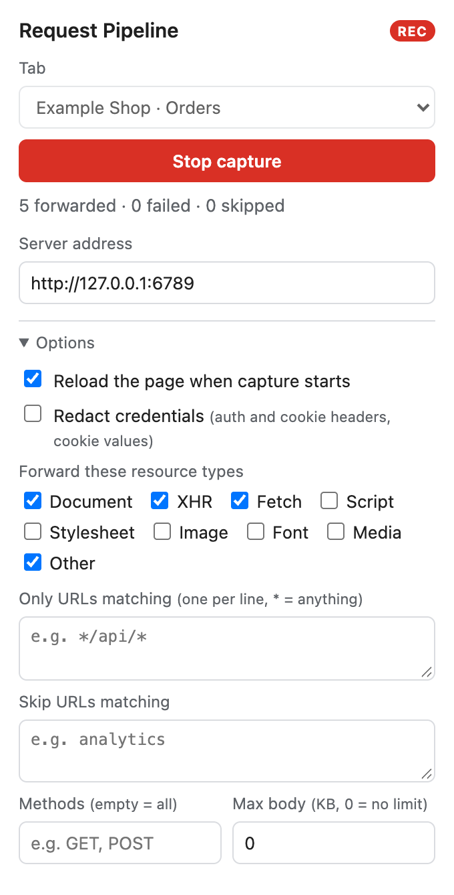

<p align="center">
  
  <h1 align="center">Request Pipeline</h1>
</p>
This is a chrome extension that forwards the content of network requests on web pages to the processing server.This extension can better help development engineers or test engineers understand the specifics of interface requests and responses in web pages.

## Under the hood

The main reason this tool uses the chrome extension as a development platform is that you don't have to use a development tool to simulate the entire workflow of the site (for example, you need to log in when getting some data). With this plugin you just need to visit the page you want to get the web request in the explorer normally, then open this plugin and you can get the data you need.

The chrome extension does not have an API that can directly obtain all requests from web pages, but there are usually two ways to achieve this function.

1. By extending the ability to inject javascript into the webpage, this implementation method is to inject javascript code into the header of the target webpage, and the main content of the javascript code is to hijack the xhr request of the webpage. But there is also a problem. When the request is generated before the dom node of the web page, this method cannot be captured.
2. Another method is based on `chrome.devtools.network` API, which is more convenient, but the only problem is that you need to keep devtools open during the capture request. Because this API can only be called in the devtools toolbar.

What I am currently implementing is based on the debugger API, which is actually used for remote debugging of applications that support Chrome DevTools Protocol. Chrome itself supports this protocol.

The debugger API mainly requires two steps, Attaches debugger to the given target and Detaches debugger from the given target.

After attaching the debugger to a given target, we can use `sendCommand` method to issue instructions to the debugger.For specific commands that can be used, refer to [here](https://chromedevtools.github.io/devtools-protocol/).

This extension mainly focuses on the [debugger's Network](https://chromedevtools.github.io/devtools-protocol/tot/Network/)。

First we need to enable network tracking, the `Network.enable` command.

Then we need to catch the debugger event, through `chrome.debugger.onEvent`.

Finally filter the event content I need.

### About Debugger Network Event

A network request is split into many events in the debugger. Take the HTTP network request as an example:

- `Network.dataReceived` is fired when data chunk was received over the network.
- `Network.eventSourceMessageReceived` is fired when EventSource message is received.
- `Network.loadingFailed` is fired when HTTP request has failed to load.
- `Network.loadingFinished` is fired when HTTP request has finished loading.
- `Network.requestServedFromCache` is fired if request ended up loading from cache.
- `Network.requestWillBeSent` is fired when page is about to send HTTP request.
- `Network.responseReceived` is fired when HTTP response is available.
- and more

The three main events I use in this extension are `Network.requestWillBeSent`, `Network.responseReceived`, and `Network.loadingFinished`.

`Network.requestWillBeSent` in this event I get the request submit data.

`Network.responseReceived` in this event I get response data and cookies.

`Network.loadingFinished` In this event, I get the response body data through the `Network.getResponseBody` method, because this is the last of all events.

At this point, all the necessary data are obtained.

### One more thing

Only http(s) requests are forwarded. By default, static assets (stylesheets, scripts, images, fonts, media, manifests and CORS preflights) are filtered out by their [resource type](https://chromedevtools.github.io/devtools-protocol/tot/Network/#type-ResourceType); you can change this under **Options**.

Cross-site iframes and workers run as separate debugging targets, so the tab's own session doesn't see their traffic. The extension uses `Target.setAutoAttach` to attach to each one as it starts (pausing it until its network tracking is on), so their requests are captured too. WebSocket messages (`Network.webSocketFrameSent` / `Received`) and EventSource messages (`Network.eventSourceMessageReceived`) can be forwarded as well; see **Options** below.

## Install

- [chrome web store](https://chrome.google.com/webstore/detail/request-pipeline/kkaplobblnfnadlodpgdehhieofppead)
- If you want to use it right away, you can clone this repository, then click the Load unzipped extensions button in the chrome extension manager and select the plugin directory in the window that opens to use it.

## Quick start

The extension sends each captured request to a server you run. A ready-made one is included (Python 3.8+, no dependencies):

```bash
python3 examples/receiver.py
```

It listens on `http://127.0.0.1:6789`, the extension's default address, and prints one line per request:

```
200 GET     https://api.example.com/orders  (application/json, 1.2 KB, 85 ms)
```

To keep what you capture, add `--jsonl requests.jsonl` (one record per line) and/or `--har capture.har` (a HAR file you can open in Chrome DevTools or other HTTP tools; WebSocket messages are stored on their connection's entry the way DevTools exports them). Use `--port` to listen elsewhere.

## Use



1. Click the extension's icon to open the popup. If you don't see it in the toolbar, click the puzzle icon, find Request Pipeline and pin it.
2. Pick the **Tab** to capture (the current tab is preselected) and click **Start capture**. Chrome shows a "Request Pipeline started debugging this browser" banner; **don't press Cancel on it while you want to capture**.
3. Click **Stop capture** when you're done (Cancel on the banner, or closing the tab, also stops it).



While capturing, the popup shows how many records were forwarded, failed to send, or skipped (no response body available), and the toolbar badge shows the forwarded count. The badge turns red if forwarding fails; the popup then shows the error.

**Server address** is where records are POSTed. It's saved as you type and applies right away, including to a running capture. Leave it empty to stop forwarding. If it points anywhere other than this computer, the popup warns you, since records include cookies and auth headers unless you turn on redaction.

**Options**, all applied immediately:

- **Reload the page when capture starts**: catches the requests a page makes while loading.
- **Redact credentials**: replaces the values of `Authorization`, `Proxy-Authorization`, `Cookie`, `Set-Cookie`, `X-Api-Key`, `X-Auth-Token`, `X-CSRF-Token` and `X-XSRF-Token` headers, and all cookie values, with `[REDACTED]`. URLs and bodies are not changed.
- **Forward these resource types**: which kinds of requests are sent.
- **Only URLs matching / Skip URLs matching**: one pattern per line. `*` matches anything, so `https://api.example.com/*` matches the whole URL; a pattern without `*` matches any URL containing it. Skip wins over Only.
- **Methods**: e.g. `GET, POST`. Empty means all.
- **Max body**: request and response bodies, and WebSocket and SSE message data, longer than this many KB are replaced by a marker (see below). 0 means no limit.
- **Forward WebSocket messages** / **Forward EventSource (SSE) messages**: off by default. Each socket open, message, error and close, and each SSE message, is sent as its own record (see below). URL patterns, the size limit and redaction apply. Only sockets and streams opened after capture starts are seen, so combine this with **Reload the page** to catch those a page opens while loading.

<br clear="right">

### Data format

The extension POSTs one **JSON** record per request (or per WebSocket/SSE event). `kind` says which shape it has; receivers written for older versions can treat a record without `kind` as `"http"`.

#### HTTP records (`"kind": "http"`)

| FIELD             | TYPE | NOTE |
| ----------------- | ---- | ---- |
| **schema_version** | **number** | `1`. Records from versions before 1.2 don't have this field. |
| **kind**          | **string** | `"http"`. Added in 1.3. |
| **request_id**    | **string** | The Chrome DevTools request ID, unique within the target that made it. |
| **tab_id**        | **number** | The captured tab. |
| **target_type**   | **string** | What made the request: `page` (the tab), `iframe` (a cross-site iframe), `worker`, `shared_worker`, `service_worker`. Added in 1.3. |
| **document_url**  | **string** | URL of the document that made the request. |
| **resource_type** | **string** | [ResourceType](https://chromedevtools.github.io/devtools-protocol/tot/Network/#type-ResourceType), e.g. `XHR`, `Fetch`, `Document`. |
| **timestamp**     | **number** | When the request was sent, in milliseconds since the Unix epoch. |
| **duration_ms**   | **number** | From sending the request to the response finishing. |
| **request**       | [Request](https://chromedevtools.github.io/devtools-protocol/tot/Network/#type-Request) | https://chromedevtools.github.io/devtools-protocol/tot/Network/#event-requestWillBeSent |
| **response**      | [Response](https://chromedevtools.github.io/devtools-protocol/tot/Network/#type-Response) | https://chromedevtools.github.io/devtools-protocol/tot/Network/#event-responseReceived |
| **cookies**       | **array**[ [Cookie](https://chromedevtools.github.io/devtools-protocol/tot/Network/#type-Cookie) ] | https://chromedevtools.github.io/devtools-protocol/tot/Network/#method-getCookies |
| **response_body** | **object** `{ body, base64Encoded }` | https://chromedevtools.github.io/devtools-protocol/tot/Network/#method-getResponseBody |

- `request.postData` contains the full request body, including bodies too large for Chrome to include in the event.
- `cookies` is left out if Chrome couldn't return them.
- Requests whose response body Chrome no longer has (redirects, evicted buffers) are not forwarded; they count as *skipped*.
- When a body is over the **Max body** limit, `response_body` becomes `{ "body": null, "base64Encoded": …, "omitted": "too_large", "length": <characters> }`, and the request gets `"postData": null, "postDataOmitted": "too_large", "postDataLength": <characters>`.
- A response streamed with `fetch()` (rather than EventSource) arrives as one HTTP record once it finishes.

#### WebSocket records (`"kind": "websocket"`, when turned on)

Every record has `schema_version`, `kind`, `request_id` (one per socket), `tab_id`, `target_type`, `url` and `timestamp` (milliseconds since the epoch), plus `event`:

| `event` | Extra fields |
| ------- | ------------ |
| `open` | `request: { headers }` and `response: { status, statusText, headers }` from the handshake. |
| `message` | `direction` (`"sent"` / `"received"`), `opcode` (1 text, 2 binary), `data` (text, or base64 for binary), `base64Encoded`. Over the size limit: `data: null`, `omitted: "too_large"`, `length`. |
| `error` | `error_message`. |
| `close` | None. |

Records of one socket are sent in order. With redaction on, the handshake's credential headers are redacted; message data is not.

#### EventSource records (`"kind": "sse"`, when turned on)

`schema_version`, `kind`, `event: "message"`, `request_id` (one per stream), `tab_id`, `target_type`, `url`, `document_url`, `timestamp`, `event_name`, `event_id` and `data` (with the same size-limit marker). The EventSource request itself doesn't produce an HTTP record.

## Development

The extension is plain JavaScript with no build step: load the repository folder with **Load unpacked** and reload it after changes. Node.js 22.2 or later is only needed for the tooling.

```bash
npm install
npm run check      # lint (ESLint + Prettier), type check, unit tests
npm run format     # apply Prettier
npm run package    # dist/request-pipeline-<version>.zip, the file uploaded to the Chrome Web Store
npm run test:e2e   # browser tests: loads the extension in Chromium and drives the popup
```

- **Layout**: `background.js` (service worker) wires Chrome events to the logic in `lib/`, which has no `chrome.*` calls: `filter.js`, `record.js`, `redact.js`, `forward.js`. `config.js` holds the settings, their defaults and the shared types.
- **Types** are JSDoc comments checked by TypeScript in strict mode (`npm run typecheck`); nothing is compiled.
- **Unit tests** (`test/`) replay Chrome DevTools Protocol event sequences against `background.js` with a fake `chrome` API.
- **Browser tests** (`e2e/`) need Python 3 for `examples/receiver.py` and a Chromium build: run `npx playwright install chromium` once, or set `CHROME_PATH` to a Chrome for Testing or Chromium binary (branded Chrome no longer loads unpacked extensions from the command line). `EXTENSION_DIR` loads another directory, such as the unzipped package, and `SCREENSHOT_DIR` saves popup screenshots in light and dark mode.
- **Packaging** follows what the manifest actually loads, so only those files go into the zip; a reference to a missing file fails the build.

CI runs all of the above on every pull request, with the browser tests on the unzipped package.

### Releasing

1. Set `version` in `manifest.json`, and in `CHANGELOG.md` change the section heading from `Unreleased` to today's date.
2. Merge, then tag `main` and push the tag: `git tag v1.2.0 && git push origin v1.2.0`.
3. The release workflow checks that the tag, `manifest.json` and `CHANGELOG.md` agree, runs the checks, and publishes a GitHub release with the zip attached and the changelog section as notes.
4. Upload that zip in the [Chrome Web Store developer dashboard](https://chrome.google.com/webstore/devconsole).

The Store listing text (description, permission justifications) is in `store/listing.md`, and its screenshots and promo tiles in `store/images/`. When the popup changes, regenerate the images from the version being published: unzip it, then run `EXTENSION_DIR=<that folder> npm run store-assets`.

## reference

https://developer.chrome.com/docs/extensions/reference/#stable_apis

https://chromedevtools.github.io/devtools-protocol/tot/Network/


## Thanks

[Pipeline icons created by Becris - Flaticon](https://www.flaticon.com/free-icons/pipeline)

[Chrome Extension: "No resource with given identifier found" when trying to Network.getResponseBody](https://stackoverflow.com/questions/47962104/chrome-extension-no-resource-with-given-identifier-found-when-trying-to-netwo)

[Chrome Extension - How to get HTTP Response Body?](https://stackoverflow.com/questions/18534771/chrome-extension-how-to-get-http-response-body)
