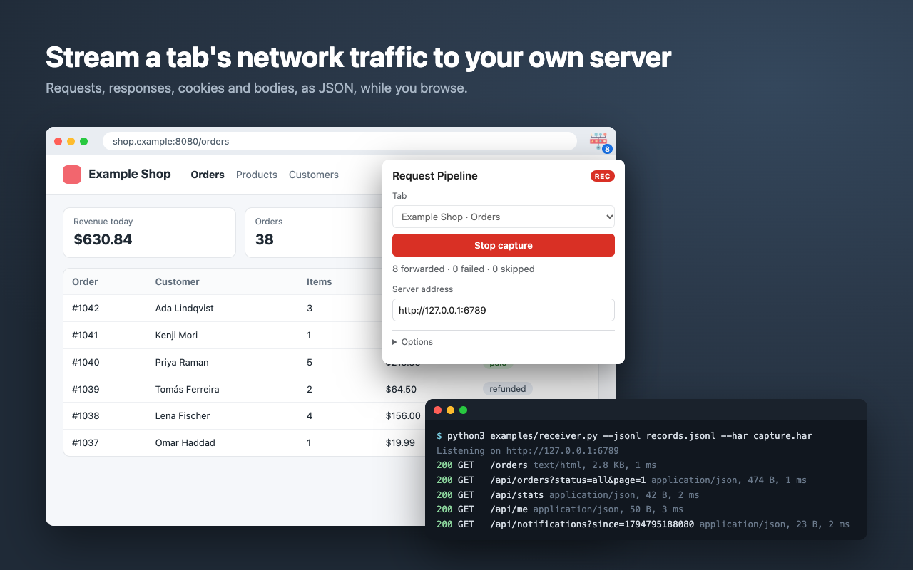
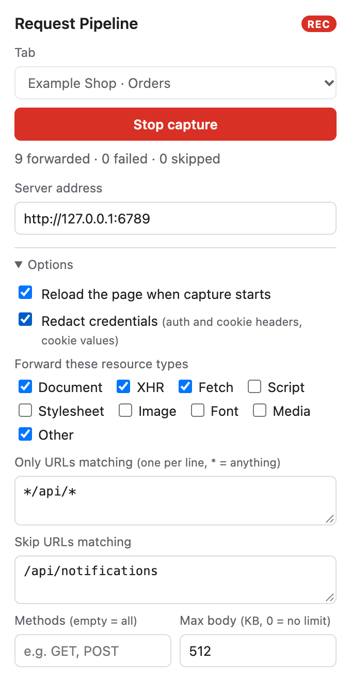

<p align="center">
  
</p>

<h1 align="center">Request Pipeline</h1>

<p align="center">
  <b>Pipe a tab's network traffic into your own code.</b><br>
  A Chrome extension that forwards each request a tab makes, with headers, bodies, cookies and timing, to a server you run, as JSON, while you browse.
</p>

<p align="center">
  <a href="https://chromewebstore.google.com/detail/request-pipeline/kkaplobblnfnadlodpgdehhieofppead"><b>Add to Chrome</b></a> ·
  <a href="https://www.ganymedenil.com/request-pipeline/">Website</a> ·
  <a href="#quick-start">Quick start</a> ·
  <a href="https://www.ganymedenil.com/request-pipeline/privacy.html">Privacy</a>
</p>

<p align="center">
  <a href="https://chromewebstore.google.com/detail/request-pipeline/kkaplobblnfnadlodpgdehhieofppead"></a>
  <a href="https://chromewebstore.google.com/detail/request-pipeline/kkaplobblnfnadlodpgdehhieofppead"></a>
  <a href="https://github.com/GanymedeNil/request-pipeline/actions/workflows/ci.yml"></a>
  <a href="LICENSE"></a>
</p>

<p align="center">
  
</p>

## Why Request Pipeline

- **Works in the tab you already have open.** Signed in, with real data. No proxy, no certificates, no DevTools left open.
- **Streams, not exports.** Each request reaches your code as soon as it finishes, so scripts, tests and tools can react while you browse.
- **Complete records.** Full request bodies (even large ones), response bodies, cookies and timing, in the shape of the Chrome DevTools Protocol.
- **Your data stays yours.** Records go only to the server address you set, your own computer by default. The extension has no analytics and sends nothing to the developer.

People use it to record API traffic for mocks and tests, collect data from pages they can only reach when logged in, see exactly what a web app sends, and save sessions as HAR files.

## Quick start

1. **Install** Request Pipeline from the [Chrome Web Store](https://chromewebstore.google.com/detail/request-pipeline/kkaplobblnfnadlodpgdehhieofppead) and pin it to the toolbar.
2. **Run a receiver.** Any HTTP endpoint that accepts a JSON POST works; this repository includes one that needs only Python 3.8+:

   ```bash
   python3 examples/receiver.py
   ```

   It listens on `http://127.0.0.1:6789`, the extension's default address, and prints one line per request:

   ```
   200 GET     https://api.example.com/orders  (application/json, 1.2 KB, 85 ms)
   ```

   Add `--jsonl requests.jsonl` to keep every record, or `--har capture.har` for a HAR file that opens in Chrome DevTools.
3. **Capture.** Open the page, click the extension icon and press **Start capture**. Turn on **Reload the page** under Options to catch the requests it makes while loading. Press **Stop capture** when you're done.

While a tab is captured, Chrome shows a "Request Pipeline started debugging this browser" banner. That's how Chrome's debugger API works; pressing Cancel on it stops the capture.

## Features



**Capture**
- Documents, XHR and fetch calls by default; scripts, stylesheets, images, fonts and media when you want them.
- Full request bodies, response bodies (base64 for binary), cookies, timing and the page that made each request.
- *New in 1.3:* requests from cross-site iframes and web workers, and WebSocket and EventSource (SSE) messages.

**Control**
- Filter by resource type, URL pattern and HTTP method.
- Redact cookie values and authorization headers before they're sent.
- Replace bodies over a size limit with a marker that keeps their length.
- Every setting applies to the next request, even in the middle of a capture.

**Visibility**
- Live counts of forwarded, failed and skipped requests, and a counter on the toolbar icon that turns red when sending fails.
- A clear error when your server is down, and a warning when the server address isn't on your computer or isn't encrypted.

<br clear="right">

### Options

| Option | What it does |
| --- | --- |
| **Server address** | Where records are POSTed. Saved as you type and applied right away. Leave it empty to stop forwarding. |
| **Reload the page when capture starts** | Catches the requests a page makes while loading. |
| **Redact credentials** | Replaces the values of `Authorization`, `Proxy-Authorization`, `Cookie`, `Set-Cookie`, `X-Api-Key`, `X-Auth-Token`, `X-CSRF-Token` and `X-XSRF-Token` headers, and all cookie values, with `[REDACTED]`. URLs and bodies are not changed. |
| **Forward these resource types** | Which kinds of requests are sent. |
| **Only URLs matching / Skip URLs matching** | One pattern per line. `*` matches anything, so `https://api.example.com/*` matches the whole URL; a pattern without `*` matches any URL containing it. Skip wins over Only. |
| **Methods** | For example `GET, POST`. Empty means all. |
| **Max body** | Bodies and message data longer than this many KB are replaced by a marker. 0 means no limit. |
| **Forward WebSocket messages** / **Forward EventSource (SSE) messages** | *1.3.* Off by default. Each socket open, message, error and close, and each SSE message, is sent as its own record. Only sockets and streams opened after capture starts are seen. |

## What your server receives

One JSON POST per request. A trimmed example, with redaction on:

```json
{
  "schema_version": 1,
  "resource_type": "Fetch",
  "timestamp": 1794795192008,
  "duration_ms": 120,
  "request": {
    "method": "POST",
    "url": "https://shop.example/api/orders/1042/notes",
    "headers": { "Authorization": "[REDACTED]", "Content-Type": "application/json" },
    "postData": "{\"note\":\"Gift wrap, please\"}"
  },
  "response": { "status": 201, "mimeType": "application/json", "headers": { "...": "..." } },
  "cookies": [{ "name": "session", "value": "[REDACTED]", "...": "..." }],
  "response_body": { "body": "{\"id\":\"n_88\",\"created\":true}", "base64Encoded": false }
}
```

Every field is described under [Data format](#data-format).

## Privacy

The extension reads the network traffic of the tab you choose, only while you're capturing it, and sends it only to the server address you set. Nothing goes to the developer: no analytics, no telemetry, no remote code. Records can contain cookies and auth headers, so forward them only to servers you trust, or turn on **Redact credentials**. The full [privacy policy](https://www.ganymedenil.com/request-pipeline/privacy.html) explains what is read, sent and stored, and why each permission is needed.

## FAQ

**Why does Chrome say the extension "started debugging this browser"?**
Request Pipeline uses Chrome's debugger API, the same one DevTools uses, because it's the only extension API that can read response bodies, including those of requests made before the page's own scripts run, without DevTools open. Chrome always shows this banner while it's in use, and pressing Cancel on it stops the capture.

**Does it work on pages behind a login?**
Yes. It captures the tab you're using, with your session, so you don't need to recreate a login in another tool.

**Why are some requests counted as skipped?**
Their response body was no longer available from Chrome, which happens with redirects and with bodies Chrome has already discarded. They aren't forwarded.

**Can I capture pages I've already loaded?**
Requests made before you press Start capture aren't seen. Turn on **Reload the page when capture starts** to catch everything from the first request.

**Which browsers does it support?**
Chrome. Other Chromium-based browsers that support Manifest V3 extensions and the debugger API may work, but aren't tested.

**Can I write my own receiver?**
Yes: any endpoint that accepts a JSON POST works. [`examples/receiver.py`](examples/receiver.py) is about 300 lines of standard-library Python and a good starting point.

## Install from source

Clone the repository, open `chrome://extensions`, turn on **Developer mode**, click **Load unpacked** and choose the repository folder. This runs the code on `main`, which may be ahead of the Chrome Web Store version.

## Data format

The extension POSTs one **JSON** record per request (or per WebSocket/SSE event). `kind` says which shape it has; receivers written for older versions can treat a record without `kind` as `"http"`.

### HTTP records (`"kind": "http"`)

| FIELD             | TYPE | NOTE |
| ----------------- | ---- | ---- |
| **schema_version** | **number** | `1`. Records from versions before 1.2 don't have this field. |
| **kind**          | **string** | `"http"`. Added in 1.3. |
| **request_id**    | **string** | The Chrome DevTools request ID, unique within the target that made it. |
| **tab_id**        | **number** | The captured tab. |
| **target_type**   | **string** | What made the request: `page` (the tab), `iframe` (a cross-site iframe), `worker`, `shared_worker`, `service_worker`. Added in 1.3. |
| **document_url**  | **string** | URL of the document that made the request. |
| **resource_type** | **string** | [ResourceType](https://chromedevtools.github.io/devtools-protocol/tot/Network/#type-ResourceType), e.g. `XHR`, `Fetch`, `Document`. |
| **timestamp**     | **number** | When the request was sent, in milliseconds since the Unix epoch. |
| **duration_ms**   | **number** | From sending the request to the response finishing. |
| **request**       | [Request](https://chromedevtools.github.io/devtools-protocol/tot/Network/#type-Request) | https://chromedevtools.github.io/devtools-protocol/tot/Network/#event-requestWillBeSent |
| **response**      | [Response](https://chromedevtools.github.io/devtools-protocol/tot/Network/#type-Response) | https://chromedevtools.github.io/devtools-protocol/tot/Network/#event-responseReceived |
| **cookies**       | **array**[ [Cookie](https://chromedevtools.github.io/devtools-protocol/tot/Network/#type-Cookie) ] | https://chromedevtools.github.io/devtools-protocol/tot/Network/#method-getCookies |
| **response_body** | **object** `{ body, base64Encoded }` | https://chromedevtools.github.io/devtools-protocol/tot/Network/#method-getResponseBody |

- `request.postData` contains the full request body, including bodies too large for Chrome to include in the event.
- `cookies` is left out if Chrome couldn't return them.
- Requests whose response body Chrome no longer has (redirects, evicted buffers) are not forwarded; they count as *skipped*.
- When a body is over the **Max body** limit, `response_body` becomes `{ "body": null, "base64Encoded": …, "omitted": "too_large", "length": <characters> }`, and the request gets `"postData": null, "postDataOmitted": "too_large", "postDataLength": <characters>`.
- A response streamed with `fetch()` (rather than EventSource) arrives as one HTTP record once it finishes.

### WebSocket records (`"kind": "websocket"`, when turned on)

Every record has `schema_version`, `kind`, `request_id` (one per socket), `tab_id`, `target_type`, `url` and `timestamp` (milliseconds since the epoch), plus `event`:

| `event` | Extra fields |
| ------- | ------------ |
| `open` | `request: { headers }` and `response: { status, statusText, headers }` from the handshake. |
| `message` | `direction` (`"sent"` / `"received"`), `opcode` (1 text, 2 binary), `data` (text, or base64 for binary), `base64Encoded`. Over the size limit: `data: null`, `omitted: "too_large"`, `length`. |
| `error` | `error_message`. |
| `close` | None. |

Records of one socket are sent in order. With redaction on, the handshake's credential headers are redacted; message data is not.

### EventSource records (`"kind": "sse"`, when turned on)

`schema_version`, `kind`, `event: "message"`, `request_id` (one per stream), `tab_id`, `target_type`, `url`, `document_url`, `timestamp`, `event_name`, `event_id` and `data` (with the same size-limit marker). The EventSource request itself doesn't produce an HTTP record.

## How it works

Extensions can watch requests with `chrome.webRequest`, but it never exposes response bodies. The usual workarounds each miss something: injecting a script that wraps `fetch` and `XMLHttpRequest` can't see requests made before it runs, and `chrome.devtools.network` only works while DevTools is open.

Request Pipeline uses [`chrome.debugger`](https://developer.chrome.com/docs/extensions/reference/api/debugger) instead, which speaks the [Chrome DevTools Protocol](https://chromedevtools.github.io/devtools-protocol/tot/Network/) to the tab:

1. It attaches to the tab and sends `Network.enable`.
2. `Network.requestWillBeSent` gives the request, `Network.responseReceived` the response, and `Network.loadingFinished` signals the end. The extension then reads the body with `Network.getResponseBody`, the cookies with `Network.getCookies` and, for bodies too large to be inlined, the request body with `Network.getRequestPostData`, and sends one record.
3. Cross-site iframes and workers are separate debugging targets that the tab's session doesn't see. `Target.setAutoAttach` attaches to each one as it starts, pausing it until its network tracking is on, so their requests are captured too (1.3).
4. WebSocket frames (`Network.webSocketFrameSent` / `Received`) and EventSource messages (`Network.eventSourceMessageReceived`) are forwarded as their own records when turned on (1.3).

## Development

The extension is plain JavaScript with no build step: load the repository folder with **Load unpacked** and reload it after changes. Node.js 22.2 or later is only needed for the tooling.

```bash
npm install
npm run check      # lint (ESLint + Prettier), type check, unit tests
npm run format     # apply Prettier
npm run package    # dist/request-pipeline-<version>.zip, the file uploaded to the Chrome Web Store
npm run test:e2e   # browser tests: loads the extension in Chromium and drives the popup
```

- **Layout**: `background.js` (service worker) wires Chrome events to the logic in `lib/`, which has no `chrome.*` calls: `filter.js`, `record.js`, `redact.js`, `forward.js`. `config.js` holds the settings, their defaults and the shared types.
- **Types** are JSDoc comments checked by TypeScript in strict mode (`npm run typecheck`); nothing is compiled.
- **Unit tests** (`test/`) replay Chrome DevTools Protocol event sequences against `background.js` with a fake `chrome` API.
- **Browser tests** (`e2e/`) need Python 3 for `examples/receiver.py` and a Chromium build: run `npx playwright install chromium` once, or set `CHROME_PATH` to a Chrome for Testing or Chromium binary (branded Chrome no longer loads unpacked extensions from the command line). `EXTENSION_DIR` loads another directory, such as the unzipped package, and `SCREENSHOT_DIR` saves popup screenshots in light and dark mode.
- **Website**: `site/` holds the product page, privacy policy and terms. `npm run build-site` assembles it into `dist/site` with self-hosted fonts (the site's own files load nothing from other domains, and `test/site.test.js` checks that), and the Pages workflow publishes it whenever it changes on `main`. The domain is served through Cloudflare, which adds its own Web Analytics and bot protection to the pages; the privacy policy discloses both, so update it if those Cloudflare settings change.
- **Packaging** follows what the manifest actually loads, so only those files go into the zip; a reference to a missing file fails the build.

CI runs all of the above on every pull request, with the browser tests on the unzipped package. Changes are listed in [CHANGELOG.md](CHANGELOG.md).

### Releasing

1. Set `version` in `manifest.json`, and in `CHANGELOG.md` change the section heading from `Unreleased` to today's date.
2. Merge, then tag `main` and push the tag: `git tag v1.3.0 && git push origin v1.3.0`.
3. The release workflow checks that the tag, `manifest.json` and `CHANGELOG.md` agree, runs the checks, and publishes a GitHub release with the zip attached and the changelog section as notes.
4. Upload that zip in the [Chrome Web Store developer dashboard](https://chrome.google.com/webstore/devconsole).

The Store listing text (description, permission justifications) is in `store/listing.md`, and its screenshots and promo tiles in `store/images/`. When the popup changes, regenerate the images from the version being published: unzip it, then run `EXTENSION_DIR=<that folder> npm run store-assets`.

## Credits

- Icon: [Pipeline icons created by Becris - Flaticon](https://www.flaticon.com/free-icons/pipeline)
- [Chrome Extension: "No resource with given identifier found" when trying to Network.getResponseBody](https://stackoverflow.com/questions/47962104/chrome-extension-no-resource-with-given-identifier-found-when-trying-to-netwo)
- [Chrome Extension - How to get HTTP Response Body?](https://stackoverflow.com/questions/18534771/chrome-extension-how-to-get-http-response-body)
- References: [Chrome extension APIs](https://developer.chrome.com/docs/extensions/reference/api), [Chrome DevTools Protocol: Network](https://chromedevtools.github.io/devtools-protocol/tot/Network/)

## License

[GPL-3.0](LICENSE)
